# 新世紀エヴァンゲリオン — Omarchy 4

> *God's in his heaven. All's right with the world.*

Une famille de **4 thèmes** pour [Omarchy 4 « Quattro »](https://github.com/basecamp/omarchy) dans
l'esprit de **Neon Genesis Evangelion** et de l'anime rétro des années 90 : 55 fonds d'écran,
8 intros vidéo, un colorscheme Neovim, un fastfetch MAGI avec portrait, un prompt starship et un halo
« A.T. Field » autour de la fenêtre active.

| Thème | Ambiance |
|-------|----------|
| [`evangelion`](#evangelion--unit-01) | Unit-01 : violet et vert phosphore sur une nuit de Tokyo-3 |
| [`evangelion-unit-02`](#evangelion-unit-02) | Unit-02 : rouge cramoisi, orange danger, jaune pilote |
| [`evangelion-rei`](#evangelion-rei) | Rei : **thème clair**, blanc plugsuit, bleu Unit-00, yeux rouges |
| [`evangelion-eoe`](#evangelion-eoe) | End of Evangelion : mer de LCL rouge, blanc de Lilith, ciel noir |


---

## Installation

### Recommandée : les 4 thèmes + extras

```bash
git clone https://github.com/SoaOaoS/evangelion-theme
cd evangelion-theme
./install.sh --extras --set evangelion
```

`install.sh` copie les quatre thèmes dans `~/.config/omarchy/themes/`. Un thème copié est
considéré par Omarchy comme le tien, donc il conserve :

- `hyprland.lua` : bordures en dégradé **+ halo A.T. Field** autour de la fenêtre active ;
- `neovim.lua` : le colorscheme Evangelion fourni avec ce dépôt.

`--extras` installe en plus fastfetch et starship (tes anciennes configs sont sauvegardées en
`*.pre-evangelion`).

### Rapide : le thème Unit-01 seul

```bash
omarchy theme install https://github.com/SoaOaoS/evangelion-theme
omarchy theme set evangelion
```

Pour un thème cloné avec git, Omarchy ignore par sécurité les `.lua` (pas de halo, Neovim via
le colorscheme généré). Tout le reste (couleurs, btop, shell, fonds, intros) fonctionne.

---

## Les thèmes

### evangelion — Unit-01

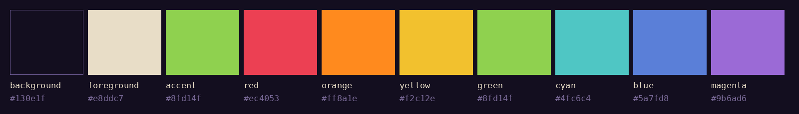

20 fonds d'écran, intros sur *Tokyo-3 Sunset* et *MAGI System Console*.

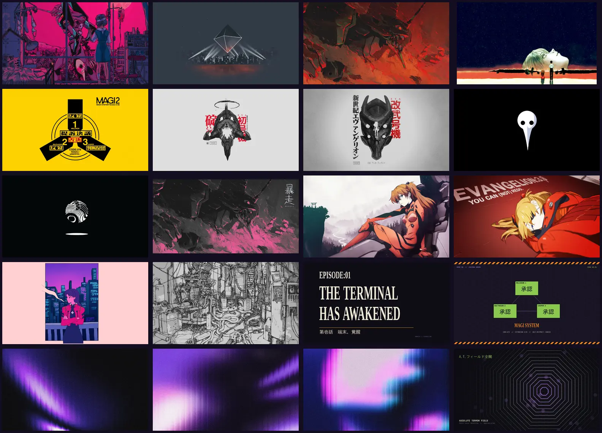

### evangelion-unit-02

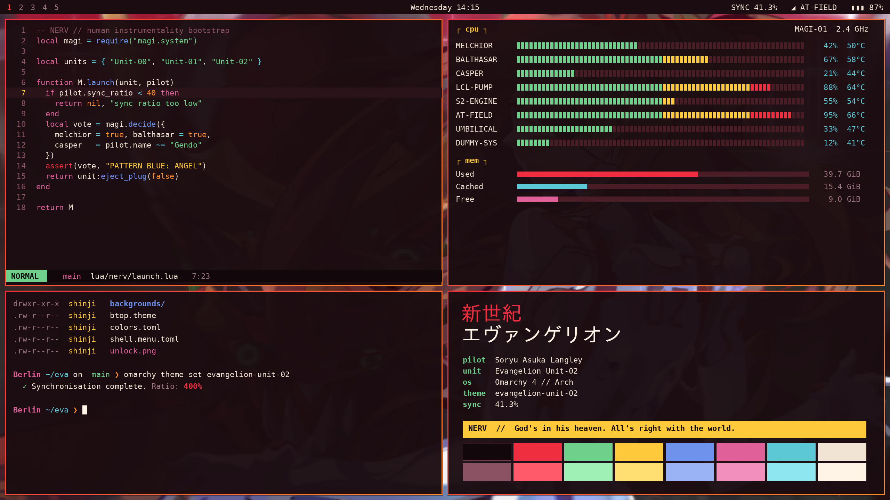
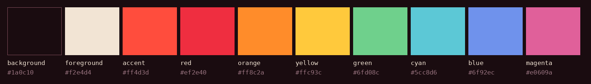

12 fonds d'écran, intros « WARNING / SYNC 400% » et « MAGI / LIMITER ».

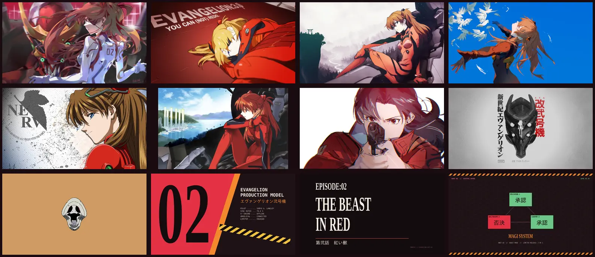

### evangelion-rei

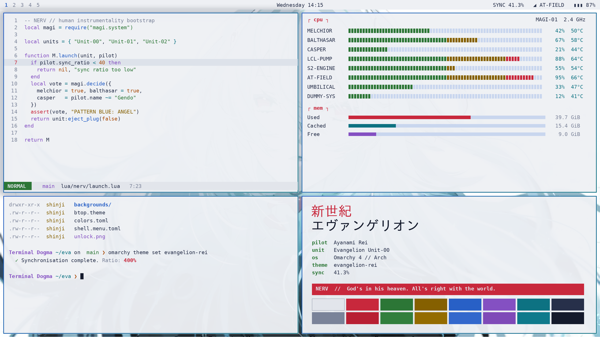
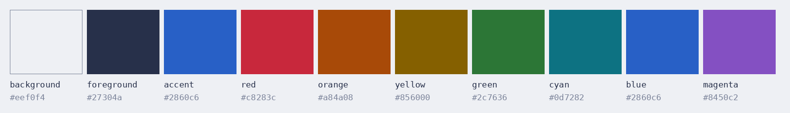

Thème clair (`mode = "light"`). 12 fonds d'écran, intros « ACTIVATION / UNIT-00 ».

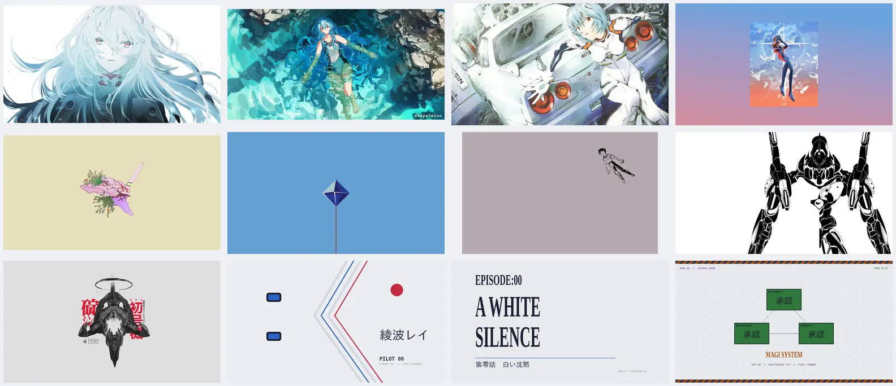

### evangelion-eoe

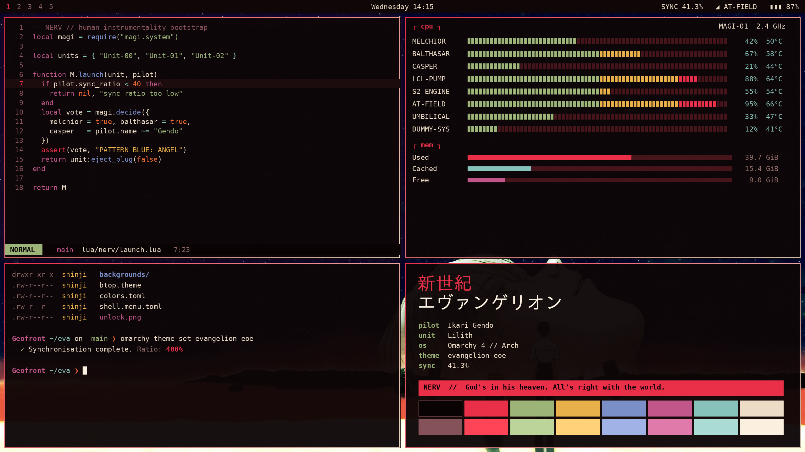


11 fonds d'écran, intros « THIRD IMPACT / AIR » et « INSTRUMENTALITY ».

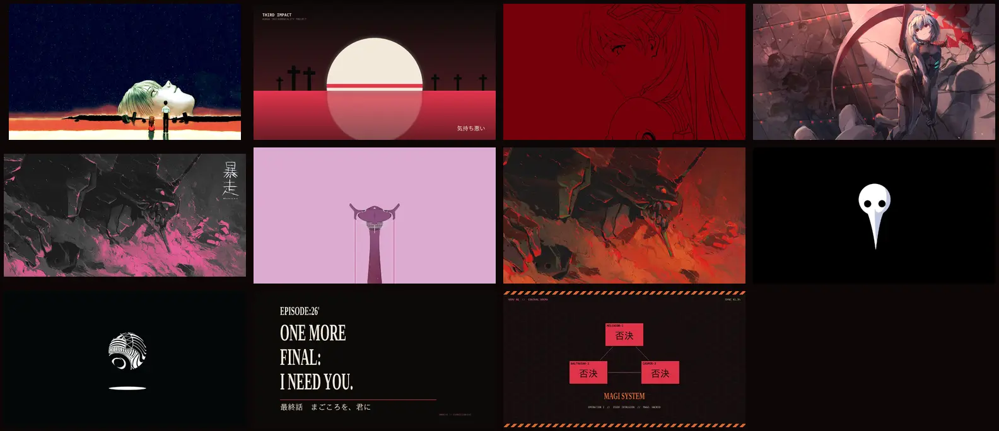

---

## Ce qui est thémé

| Élément | Fichier | Détail |
|---------|---------|--------|
| Palette | `colors.toml` | Source de toutes les configs générées par Omarchy : Alacritty, Kitty, Ghostty, Foot, Helix, VS Code, Obsidian, Chromium, GTK, Claude… |
| Fenêtres | `hyprland.lua` | Bordure en dégradé (violet→vert, rouge→orange, bleu→cyan, rouge→blanc) + halo coloré sur la fenêtre active |
| Barre | `shell.bar.toml` | Alertes (enregistrement, mises à jour) dans la couleur d'urgence du thème |
| Menus / lanceur | `shell.menu.toml`, `shell.launcher.toml` | Ligne sélectionnée avec barre latérale épaisse, façon terminal MAGI |
| Notifications | `shell.notifications.toml` | Bord dégradé, bord gauche épais, compte à rebours coloré |
| Popups / OSD | `shell.popups.toml` | Bord dégradé de 2 px |
| Verrouillage | `shell.lock.toml` | Bord neutre au repos, dégradé pendant la saisie, rouge en cas d'erreur |
| btop | `btop.theme` | Console MAGI : titres d'alerte, jauges vert → jaune → rouge |
| Démarrage | `unlock.png`, `preview-unlock.png` | Logo Omarchy dans la couleur du thème (Plymouth) |
| Icônes | `icons.theme` | Yaru-purple / Yaru-red / Yaru-blue |
| Clavier RGB | `keyboard.rgb` | Asus ROG / Framework 16 |
| Neovim | `colors/`, `lua/evangelion/` | Colorscheme complet (Treesitter, LSP, Telescope, Snacks, Neo-tree, Blink, lualine…) |
| fastfetch | `fastfetch.png` | Portrait de l'Eva du thème, cadre en dégradé (voir Extras) |
| Intros | `backgrounds/intros/*.mp4` | Vidéos de 6 s jouées à la connexion et au changement de thème |

### Neovim

Le dépôt est aussi un plugin Neovim. Hors d'Omarchy :

```lua
{ "SoaOaoS/evangelion-theme", lazy = false, priority = 1000,
  config = function() vim.cmd.colorscheme("evangelion") end }
-- evangelion | evangelion-unit-02 | evangelion-rei | evangelion-eoe
```

Options : `require("evangelion").setup({ transparent = true, italic_comments = false })`.
Pour lualine : `theme = "evangelion"`.

### Extras

- `extras/fastfetch/` : rapport « MAGI SYSTEM » en trois sections (PILOT, ENTRY PLUG,
  S² ENGINE), icônes Nerd Font, clés alignées, et **le portrait de l'Eva du thème actif** en
  vraie image. Voir ci-dessous.
- `extras/starship/starship.toml` : prompt « entry plug », `SYNC ❯` en vert, `PATTERN BLUE ❯`
  en rouge en cas d'erreur.

Les deux utilisent les couleurs ANSI du terminal et suivent donc la variante active.

#### fastfetch

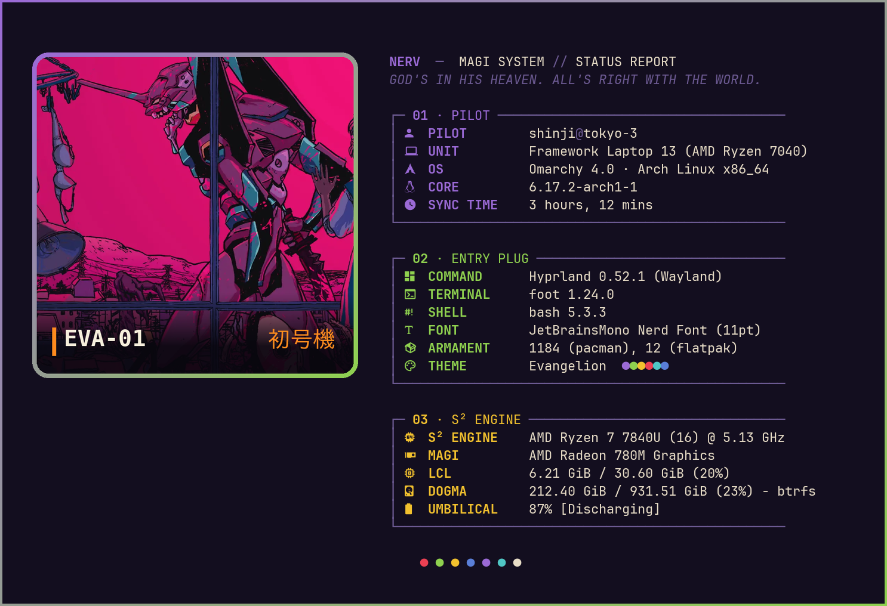

| Thème | Portrait |
|-------|----------|
| `evangelion` | EVA-01 · 初号機 |
| `evangelion-unit-02` | EVA-02 · 弐号機 |
| `evangelion-rei` | EVA-00 · 零号機 |
| `evangelion-eoe` | LILITH · 第二使徒 |

Chaque thème contient un `fastfetch.png`. `install.sh --extras` installe le hook
`~/.config/omarchy/hooks/theme-set.d/evangelion-fastfetch`, qui régénère
`~/.config/fastfetch/config.jsonc` à chaque changement de thème avec le bon portrait et le bon
protocole d'image pour ton terminal par défaut :

| Terminal | Rendu du logo |
|----------|---------------|
| foot (défaut d'Omarchy 4) | Sixel |
| Ghostty, Kitty | protocole graphique Kitty |
| Alacritty | logo texte d'Omarchy (Alacritty n'affiche pas d'images) |

Après avoir changé de terminal par défaut, relance
`~/.config/omarchy/hooks/theme-set.d/evangelion-fastfetch` (ou change de thème). La variable
`EVANGELION_TERMINAL=foot|kitty|ghostty` force la détection.

<details><summary>Les autres variantes</summary>

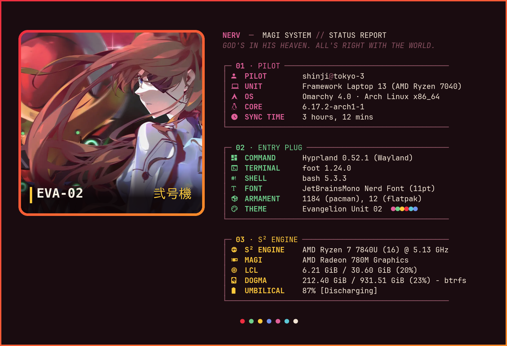
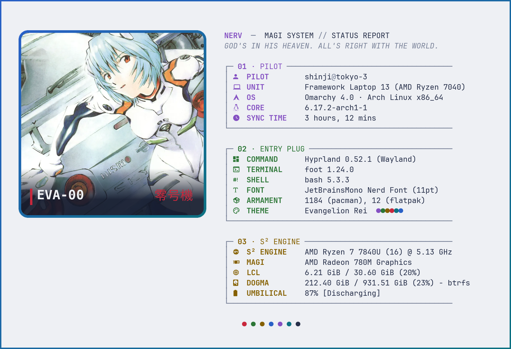
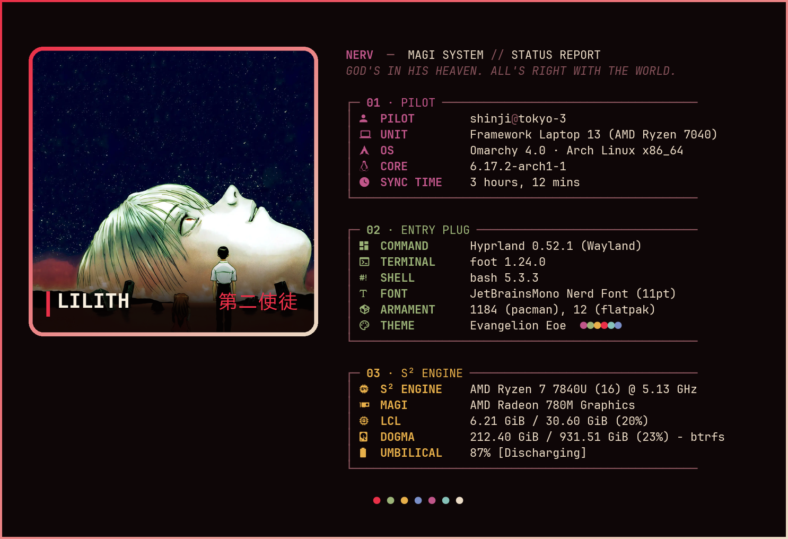

</details>

---

## Fonds d'écran : sources

| Source | Utilisée pour |
|--------|---------------|
| [dharmx/walls — evangelion](https://github.com/dharmx/walls/tree/main/evangelion) | Tokyo-3 Sunset, Ramiel, Berserk, MAGI, Unit-01 Halo, Kaishiki, Sachiel, Moon of Lilith, Geofront, Angel Mask, Unit-01 in Bloom, Ramiel Blue Sky, Shinji Adrift, Unit-01 Ink, Mass Production |
| [LuxKaiwalker/wallpapers](https://github.com/LuxKaiwalker/wallpapers) | End of Evangelion |
| [justchokingaround/wallpapers](https://github.com/justchokingaround/wallpapers) | Bousou, Misato Takes Aim |
| [Angelbitzx/Anime-Wallpapers](https://github.com/Angelbitzx/Anime-Wallpapers) | Asuka (×6), Rei in White, Rei in the Hangar, Rei in Ruins, Red Lineart |
| [JoydeepMallick/Wallpapers](https://github.com/JoydeepMallick/Wallpapers) | Misato City Pop, Rei Underwater |
| [albrp97/EVANGELION_dotfiles](https://github.com/albrp97/EVANGELION_dotfiles) | Violet Afterimage, Entry Plug Light, LCL Dream |
| [inatagan/eva-01](https://github.com/inatagan/eva-01) | Shinji in the Sky |
| Créations originales (`tools/generate-artwork.py`) | Cartes titre d'épisode, consoles MAGI, A.T. Field, Production Model 02, Plugsuit 00, Third Impact, toutes les intros |

Images converties en WebP (largeur max. 3840 px).

---

## Développement

Tout part de **`tools/palettes.py`**, la seule source de vérité. Après une modification :

```bash
python3 tools/build.py                 # configs, unlock.png, palettes Neovim
python3 tools/generate-previews.py     # preview.png, preview-unlock.png, docs/palette-*.png
python3 tools/generate-fastfetch.py    # fastfetch.png (+ --preview pour docs/fastfetch-*.png)
```

Art original et intros (Pillow + ffmpeg) :

```bash
python3 tools/generate-artwork.py evangelion-eoe impact /tmp/impact.jpg
# kinds : card, magi, atfield, hazard, impact, plugsuit
python3 tools/generate-artwork.py evangelion intro /tmp/frames backgrounds/1-tokyo-3-sunset.webp
ffmpeg -framerate 30 -i /tmp/frames/%04d.png -c:v libx264 -pix_fmt yuv420p -crf 23 -an \
  backgrounds/intros/1-tokyo-3-sunset.mp4
```

Les palettes respectent un contraste WCAG ≥ 4.5 sur le fond pour le texte et les couleurs
ANSI (≥ 3 pour `muted`), à l'exception de `brown`, purement décoratif.

```
.
├── colors.toml, *.toml, hyprland.lua, neovim.lua …   thème evangelion (Unit-01)
├── backgrounds/ (+ intros/)
├── variants/evangelion-{unit-02,rei,eoe}/            les trois autres thèmes
├── colors/, lua/evangelion/                          colorscheme Neovim
├── extras/                                           fastfetch, starship
├── tools/                                            générateurs
├── docs/                                             images du README
└── install.sh
```

## Mentions

Thème de fan non officiel. *Neon Genesis Evangelion* © khara / Gainax. Les illustrations
appartiennent à leurs auteurs respectifs et proviennent des dépôts cités ci-dessus. Le logo
Omarchy de `unlock.png` vient du projet [Omarchy](https://github.com/basecamp/omarchy).
