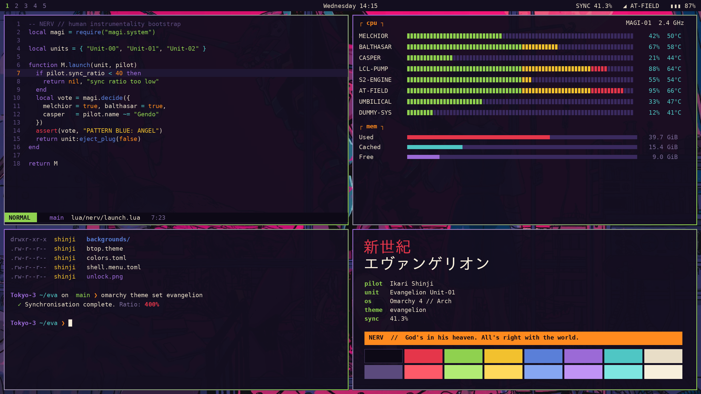

# Evangelion — thème Omarchy 4

> *God's in his heaven. All's right with the world.*

Un thème complet pour [Omarchy 4 « Quattro »](https://github.com/basecamp/omarchy) dans l'esprit de
**Neon Genesis Evangelion** et de l'anime rétro des années 90 : armure violette et vert phosphorescent
de l'Unit-01, orange d'alerte NERV, jaune MAGI, rouge LCL, le tout sur une nuit de Tokyo-3.



## Installation

```bash
omarchy theme install https://github.com/SoaOaoS/evangelion-theme
omarchy theme set evangelion
```

Ou à la main :

```bash
git clone https://github.com/SoaOaoS/evangelion-theme ~/.config/omarchy/themes/evangelion
omarchy theme set evangelion
```

## Palette

| Rôle | Couleur | Référence |
|------|---------|-----------|
| `background` | `#130e1f` | Nuit du Geofront |
| `foreground` | `#e8ddc7` | Papier de cellulo vieilli |
| `accent` / `green` | `#8fd14f` | Vert de l'Unit-01 |
| `magenta` | `#9b6ad6` | Armure de l'Unit-01 |
| `orange` | `#ff8a1e` | Alerte NERV |
| `yellow` | `#f2c12e` | Système MAGI |
| `red` | `#e5364a` | Unit-02 / EMERGENCY |
| `cyan` | `#4fc6c4` | A.T. Field / Rei |
| `blue` | `#5a7fd8` | Pattern Blue |
| `brown` | `#7d3b26` | Rouille du Geofront |
| `selection` | `#3a2a5e` | Pourpre LCL |
| `muted` | `#5b4a7d` | Crépuscule de l'entry plug |

Les bordures des fenêtres Hyprland sont un dégradé **violet → vert** à 45°, comme l'Unit-01.

## Contenu

| Fichier | Rôle |
|---------|------|
| `colors.toml` | Palette source : Omarchy en génère les configs des terminaux, Neovim, Helix, VS Code, Obsidian, Hyprland, Chromium, GTK et du shell |
| `btop.theme` | btop façon console MAGI (titres orange, boîtes violettes, jauges vert → jaune → rouge) |
| `shell.menu.toml` | Menus : ligne sélectionnée en orange NERV avec barre latérale épaisse |
| `shell.notifications.toml` | Notifications : bord dégradé Unit-01, bord gauche épais, compte à rebours orange |
| `shell.lock.toml` | Écran de verrouillage : violet au repos, dégradé violet → vert pendant la saisie, rouge en cas d'erreur |
| `icons.theme` | `Yaru-purple` |
| `keyboard.rgb` | Rétroéclairage violet Unit-01 (claviers Asus ROG / Framework 16) |
| `unlock.png`, `preview-unlock.png` | Logo Omarchy orange NERV pour Plymouth / le déverrouillage |
| `preview.png` | Aperçu dans le sélecteur de thèmes |
| `backgrounds/` | 16 fonds d'écran |
| `backgrounds/intros/1-tokyo-3-sunset.mp4` | Intro vidéo de 6 s « EMERGENCY / PATTERN BLUE » jouée à la connexion avec le fond par défaut |
| `tools/` | Scripts Python (Pillow) qui régénèrent les visuels originaux et les aperçus |

Le thème ne livre volontairement **aucun** fichier `.lua`, config de terminal ou `vscode.json` :
Omarchy les ignore pour les thèmes installés depuis git et les génère à partir de `colors.toml`.

## Fonds d'écran

| Fichier | Source |
|---------|--------|
| `1-tokyo-3-sunset` … `9-moon-of-lilith`, `14-geofront-machinery` | [dharmx/walls — evangelion](https://github.com/dharmx/walls/tree/main/evangelion) |
| `4-end-of-evangelion` | [LuxKaiwalker/wallpapers](https://github.com/LuxKaiwalker/wallpapers) |
| `10-bousou` | [justchokingaround/wallpapers](https://github.com/justchokingaround/wallpapers) |
| `11-asuka-in-the-mist`, `12-you-can-not-redo` | [Angelbitzx/Anime-Wallpapers](https://github.com/Angelbitzx/Anime-Wallpapers) |
| `13-misato-city-pop` | [JoydeepMallick/Wallpapers](https://github.com/JoydeepMallick/Wallpapers) |
| `15-episode-card`, `16-magi-system-console`, intro vidéo | Créés pour ce thème (`tools/generate-artwork.py`) |

Les images ont été converties en WebP (max. 3840 px de large).

## Régénérer les visuels

```bash
python3 tools/generate-artwork.py backgrounds/15-episode-card.webp card
python3 tools/generate-artwork.py backgrounds/16-magi-system-console.webp magi
python3 tools/generate-artwork.py /tmp/frames intro backgrounds/1-tokyo-3-sunset.webp
ffmpeg -framerate 30 -i /tmp/frames/%04d.png -c:v libx264 -pix_fmt yuv420p -crf 22 -an \
  backgrounds/intros/1-tokyo-3-sunset.mp4
python3 tools/generate-previews.py .
```

## Mentions

Thème de fan non officiel. *Neon Genesis Evangelion* © khara / Gainax. Les illustrations
appartiennent à leurs auteurs respectifs ; elles sont reprises depuis les dépôts cités ci-dessus.
